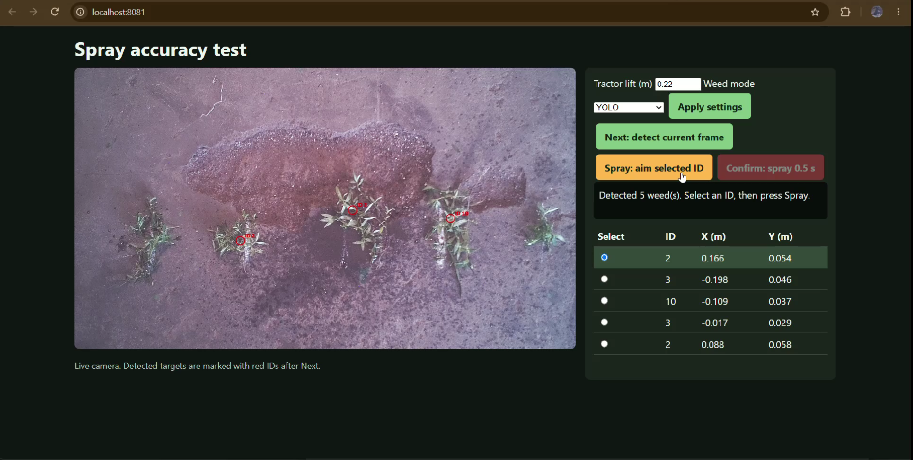
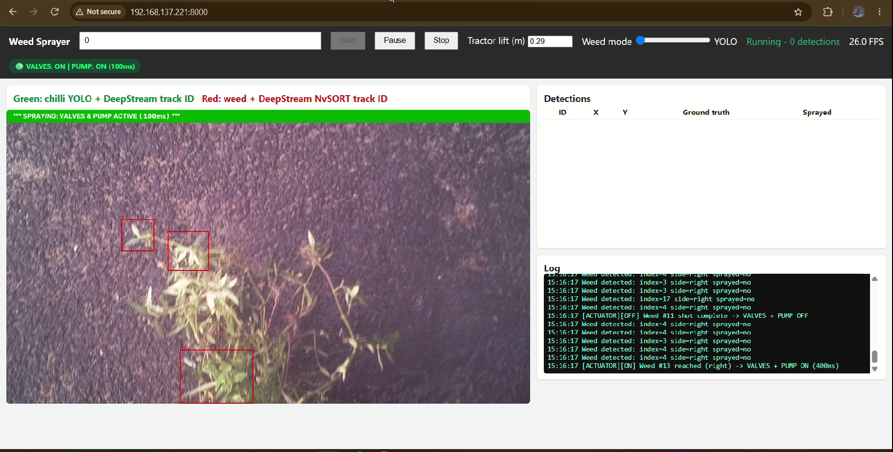

# Vision-Guided Precision Weed Detection and Dual-Nozzle Spraying System

B.Tech Project Report – I · Autumn Semester 2026–27
**Author:** Archisha Ahuja (23AG10010) · **Supervisor:** Prof. Peeyush Soni
Department of Agricultural and Food Engineering, IIT Kharagpur

A prototype that detects weeds from a downward-facing camera, estimates their position on the ground, tracks them as the platform moves, and fires one of two independently aimed spray nozzles at the right moment. The aim is to cut unnecessary herbicide use and reduce farmers' exposure to it.

---

## Demo

### Video

<video src="https://github.com/user-attachments/assets/492e3cff-de02-49fc-9724-d971d0c4f41c" controls width="100%"></video>

[Watch / download the demo video](media/precision_sprayer.mp4)

### UI
| Static test | Moving test |
|---|---|
|  |  |
| Dashboard during a stationary spray test | Dashboard during a tractor pass over the marked frame |
 

## How it works

```
CSI camera → convert / stream mux → YOLOv8 or ExG inference → NvSORT tracking
   → ground projection → per-side target queue → ESP32 (UART) → servo, valve, pump
```

- **Compute and camera:** NVIDIA Jetson Orin Nano with a Raspberry Pi CSI camera.
- **Detection:** YOLOv8m weed model deployed as an FP16 TensorRT engine in DeepStream (confidence 0.40). A GPU Excess Green (ExG = 2G − R − B) pathway is the fallback vegetation detector.
- **Tracking:** NvSORT assigns persistent IDs within the same DeepStream pipeline.
- **Ground projection:** `X = sx(u − cx)·Hc / fx`, `Y = sy(v − cy)·Hc / fy`, with camera height `Hc = 0.42 + L` and nozzle height `Hn = 0.28 + L` (`L` is tractor lift in metres).
- **Nozzle aiming:** each side has its own servo mapping, clipped to calibrated limits (left 90°–135°, right 30°–90°).
- **Actuation:** an ESP32 receives four-byte UART frames at 115200 baud and drives two servos, two relay-controlled solenoid valves and the pump. Initialisation and shutdown request all-off.
- **Spray timing:** 0.30 s servo settling and a 0.20 s pulse. At a nominal 6.25 mL/s per nozzle, one pulse delivers about 1.25 mL.

## Weed model (training log)

| Item | Value |
|---|---|
| Base model | COCO-pretrained YOLOv8m |
| Input / batch | 640 × 640 / 4 |
| Epochs run | 59 (maximum 100, patience 30) |
| Selected checkpoint | Epoch 29, chosen by mAP@0.5:0.95 |
| Precision / recall | 77.2% / 77.1% |
| mAP@0.5 / mAP@0.5:0.95 | 79.9% / 39.9% |

Labels are collapsed to a single class, `weed`. These are validation metrics from the training log; no independent held-out test metrics were supplied.

## Camera calibration

Intrinsics are stored for 1920 × 1080 with a reprojection RMS of 2.45 px. This measures calibration fit, not ground-position accuracy.

## Test methodology

- Water is used as the spray liquid, with weed positions marked on a 0.5 m × 2 m frame (1 m²).
- **Static:** 10 runs of six or seven marked weeds each.
- **Moving:** garden tractor in L1 gear at about 1.5 km/h; four densities (2, 7, 15 and 25 weeds per frame) × four runs = 16 runs.
- **Hit:** wet-spot centre within 50 mm of the marked weed centre.
- **Metrics:** detection accuracy = detected / actual; spray accuracy = hits / detected; overall coverage = hits / actual.

## Results

> **Note:** the run-level counts in the report are illustrative figures that demonstrate the calculations. They are not measured field observations and do not establish field performance, herbicide savings or agronomic efficacy.

| Illustrative measure | Value |
|---|---|
| Static detection accuracy | 44 / 65 = 67.7% |
| Static spray accuracy | 33 / 44 = 75% |
| Moving spray accuracy | 39 / 98 = 39.8% |
| Evening vs daylight detection | 53.8% vs 30.8% |

## Limitations

- Detection depends on lighting and white balance; ExG finds green vegetation, not weeds specifically.
- The chilli/crop detector is in the pipeline but awaits a sufficiently accurate trained model, so crop exclusion is not yet validated.
- Ground mapping assumes a flat surface and a nadir camera. The supplied runtime does not yet undistort points before projection.
- Control is open-loop: there is no feedback on servo position, valve closure, pressure or flow.
- The batched valve command can energise both valves, so independent per-nozzle selectivity must be verified on the rig.
- Dataset provenance (exact Kaggle source, version, licence) and software versions still need to be recorded.

## Future work

- Larger, timestamped dataset with real weeds, young chilli plants, shadows and varied lighting.
- Consistent undistortion and calibration across the working area and several lift heights.
- Speed measurement and timestamp-based target prediction for moving spraying.
- Servo feedback, independent valve commands, and pressure or flow sensing.
- Field trials with matched blanket-spraying comparisons to measure liquid savings.


## Requirements

- **Training:** Python, CUDA-enabled PyTorch and torchvision, Ultralytics.
- **Jetson deployment:** compatible JetPack / CUDA / TensorRT and DeepStream installation, plus the custom YOLO parser library (`libnvdsinfer_custom_impl_Yolo.so`).
- **Control:** `pyserial`, ESP32 UART firmware, optional CuPy matched to the CUDA version.
- **Assets:** separate ONNX and engine files for the weed and chilli models, camera calibration file, and ExG tuning profile.

Build and verify the full set on the Jetson; an unversioned `pip list` does not make a setup reproducible.

## Acknowledgements

Thanks to Prof. Peeyush Soni for guidance, Research Scholar Bhavesh Sukdeve for mentoring, JPO Satyam Singh, Shashi Kant Rawat, and the departmental staff who helped with the camera setup, electronics, tractor mounting and field preparation.

## References

1. Ultralytics. YOLOv8 documentation: https://docs.ultralytics.com/
2. NVIDIA. DeepStream SDK documentation: https://docs.nvidia.com/metropolis/deepstream/
3. NVIDIA. TensorRT documentation: https://docs.nvidia.com/deeplearning/tensorrt/
4. OpenCV. Camera calibration and 3D reconstruction: https://docs.opencv.org/4.x/d9/d0c/group__calib3d.html

## License

Add a license here (for example MIT) once chosen.
